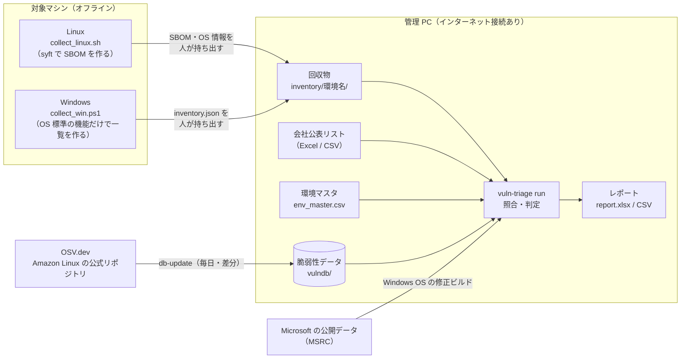
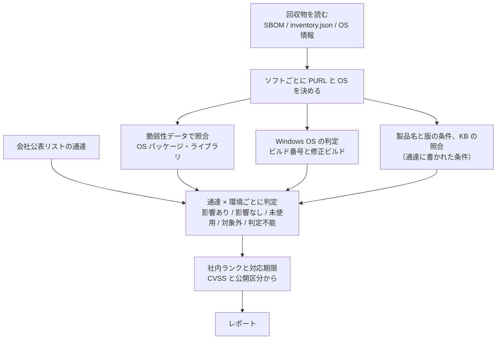

# vuln-triage

会社が公表した脆弱性の通達（Excel）ごとに、**社内のどのサーバーが影響を受けるか**を判定し、社内ランクと対応期限をつけてレポートにするツールです。インターネットにつながらないサーバー（AWS EC2 / EMR / Lambda、Linux、Windows）を対象にします。

## 特徴

- **対象のサーバーに exe を持ち込まない。** Windows は PowerShell のスクリプトだけ、Linux はスクリプトと syft（単体で動くプログラム）だけで、入っているソフトの一覧を作ります。サーバーには何もインストールせず、設定も変えません。
- **通達が起点。** 会社公表リストの通達 1 件ごとに、すべての環境について「影響あり / 影響なし / 未使用 / 対象外 / 判定不能」のどれかを必ず出し、社内ランクと対応期限をつけます。
- **脆弱性のデータは手元に持つ。** 管理 PC が OSV.dev と Amazon Linux の公式情報を毎日差分で取得し、照合は手元のデータだけで行います。回収したソフトの一覧を外部に送りません。
- **OS パッケージもライブラリも見る。** Ubuntu / Debian / RHEL 系 / Amazon Linux / Alpine の OS パッケージ、Java・Python・npm・NuGet・Go・Rust・Ruby などのライブラリ、Windows OS（Microsoft の修正ビルド番号）と適用済みの更新プログラム（KB）を判定します。
- **黙って漏らさない。** 回収し忘れたホスト、読めなかったフォルダ、照合できなかったパッケージ、読まなかった通達の行は、「判定不能」や警告としてレポートに出します。
- **対応に使える形で出す。** 「要更新パッケージ」（どのパッケージをどの版に上げればよいか）と「前回との差分」（新たに影響あり / 解消）を出します。
- **毎日自動で動く。** 管理 PC のタスクスケジューラで、データの更新から照合・レポート作成までを毎日行います。
- **実機と CI で確かめている。** Windows 11 / Windows Server 2025 / Ubuntu 24.04 / Amazon Linux 2・2023 の実機やコンテナで回収から照合までを通し、Grype などの他のツールと結果を比べています。

## 用語

| 用語 | 意味 |
|---|---|
| 対象マシン | 脆弱性を調べたいサーバー（ターゲットマシン）。インターネットにつながらない前提 |
| 管理 PC | ツール本体（`vuln-triage`）を動かす Windows の PC。インターネットにつながる。回収物を集めて照合し、レポートを作る |
| 回収スクリプト | 対象マシンで実行して、入っているソフトの一覧を作るスクリプト。Linux は `collect_linux.sh`、Windows は `collect_win.ps1` |
| SBOM | ソフトウェア部品表（Software Bill of Materials）。入っているソフトの名前・版・種類の一覧。このツールは CycloneDX という形式の JSON を使う |
| syft | SBOM を作る無償のツール（Anchore 社）。Linux の回収で使う。単体のプログラムなので、持ち込んで展開するだけで動く |
| 回収物（インベントリ） | 回収スクリプトが出すファイル。Linux は SBOM（`cdx_syft.json`）と OS 情報（`os_info.json`）、Windows は `inventory.json`。人が管理 PC に持ち込む |
| 環境 | 判定の単位。ふつうは対象マシン 1 台。管理 PC では回収物を置くフォルダの名前が環境名になる |
| 環境マスタ | 環境の一覧（`env_master.csv`）。外部公開か社内限定か（ランクの決め方が変わる）と、回収漏れの検出に使う |
| 会社公表リスト（通達） | 会社が公表する脆弱性の一覧（Excel / CSV）。1 行が通達 1 件。CVE 番号、製品名と影響する版、KB 番号のどれかで書かれる |
| 脆弱性データ（脆弱性 DB） | 「どのパッケージのどの版に、どの脆弱性があり、どの版で直ったか」のデータ。管理 PC が OSV.dev と Amazon Linux の公式リポジトリから取得し、`vulndb/` に置く |
| PURL | パッケージを表す決まった書き方（例 `pkg:maven/org.apache.logging.log4j/log4j-core@2.14.1`）。SBOM の各ソフトにつき、脆弱性データとの照合に使う |

## 全体の構成

- **対象マシンからは何も外に出ません。** 回収物は人が持ち出して管理 PC に置きます（ネットワーク越しには集めません）。
- **管理 PC が外部に送るのは**、取得するデータの名前（Maven、Ubuntu など）と、通達の CVE 番号（Windows OS の判定のため Microsoft へ）だけです。ソフトの一覧やホスト名は送りません。

## 処理の流れ

| 順 | 誰が | どこで | 何をする |
|---|---|---|---|
| 1 | 人 | 対象マシン | 回収スクリプトを実行する。入っているソフトの一覧（SBOM など）ができる |
| 2 | 人 | 管理 PC | 回収物を `inventory/環境名/` に、会社公表リストを決まったフォルダに置く |
| 3 | 自動（毎日） | 管理 PC | 脆弱性データを更新する（`db-update`）。前回から変わった分だけを取得する |
| 4 | 自動（毎日） | 管理 PC | 照合と判定を行い、日付ごとのフォルダにレポートを出す（`run`）。前回のレポートとの差分もつける |
| 5 | 人 | 管理 PC | レポートを見て、更新するパッケージと期限を決めて対応する |

照合は毎日最新の脆弱性データで行うので、**新しい脆弱性は回収をし直さなくても毎日見つかります**。回収をし直すのは、対象マシンのソフトが変わったとき（更新、追加）です。

## 照合と判定の仕組み

- **版の比べ方はパッケージの種類ごとに違います**（Debian / Ubuntu、RPM、Maven、PyPI などの規則）。比べられない版は、安全側に「影響あり（比較不能）」にします。
- **Linux の OS パッケージは、ディストリビューションの修正情報で判定します。** 版の数字が古く見えても、ディストリビューションが修正を取り込んでいれば「影響なし」です。
- **確かめられないものは「影響なし」にしません。** 回収できていない環境、版が分からない製品、照合のデータが無いパッケージは「判定不能」か「影響あり（比較不能）」になります。
- 詳しい仕組みは [docs/DESIGN.md](docs/DESIGN.md) にあります。

## レポート

| シート | 内容 |
|---|---|
| サマリ | 件数、注意事項（回収漏れ、古いデータ、照合できなかったもの）、結果の限界 |
| 通達別一覧 | 通達ごとの総合判定と、判定ごとの環境の一覧。会社への回答に使う |
| 前回との差分 | 前回のレポートと比べた「新たに影響あり」「解消」など |
| 要更新パッケージ | 環境 × パッケージごとに、すべての脆弱性が直る版、件数、最も厳しいランクと期限。**対応はここから始める** |
| 通達×環境 | 通達と環境の一覧表 |
| 明細 | すべての判定（影響なし・未使用を含む）。証跡になる |
| 新規検出（参考） | 通達には無いが、脆弱性データとの照合で見つかったもの |
| 収集状況 | 環境ごとの回収日時、回収できたもの・できなかったもの |

## 動作環境

| | 必要なもの |
|---|---|
| 管理 PC | Windows（Linux でも動く）、Python 3.10 以降、インターネット接続（OSV.dev、Amazon Linux のリポジトリ、Microsoft）、空きディスク 2 GB 以上 |
| 対象マシン（Linux） | bash、syft の tar.gz（amd64 / arm64）。root での実行を推奨 |
| 対象マシン（Windows） | Windows PowerShell 5.1 以降。管理者での実行を推奨 |

## 判定できないもの

脆弱性データに無い製品（商用ソフトなど）、実行ファイル本体（カーネルのイメージ、node・python のバイナリ）、Windows の OS 以外の Microsoft 製品（Office、SQL Server など）、コンテナの中身などは自動では判定できません。これらは通達に製品名と版の条件を書けば照合できます。一覧と代わりの方法は [docs/ROLLOUT.md](docs/ROLLOUT.md) の 7 章にあります。「影響あり」は版の一致を意味し、実際に攻撃できるかどうかは人が判断します。

## 品質

- push のたびに GitHub Actions で、単体テスト（Windows / Linux、Python 3.10 / 3.13）と、Windows Server 2025・Amazon Linux 2023・Ubuntu 24.04 での回収から照合までの試験、毎日の自動実行の試験を行います。syft は固定の版と最新の版の両方で試します。
- 実機の SBOM で Grype と結果を比べ、差を 1 件ずつ確かめています（[docs/COMPARISON.md](docs/COMPARISON.md)）。
- 見つけて直した不具合と、同じ種類の不具合を防ぐ検査は [docs/DEFECTS.md](docs/DEFECTS.md) にあります。

## 文書

| 文書 | 内容 |
|---|---|
| [docs/USAGE.md](docs/USAGE.md) | **使い方。** セットアップ、回収、入力ファイル、実行、レポートの読み方 |
| [docs/ROLLOUT.md](docs/ROLLOUT.md) | **本番導入の計画。** 自動化の範囲、人の作業と頻度、本番投入前のチェックリスト、リスクと対策、判定できないもの |
| [docs/OPERATIONS.md](docs/OPERATIONS.md) | 運用の手引き。本番前の確認、対象マシンへの影響、回収物の扱い、対応の流れ、困ったとき |
| [docs/DESIGN.md](docs/DESIGN.md) | 仕組み（データの取得、照合、判定の流れ） |
| [docs/COMPARISON.md](docs/COMPARISON.md) | 他のツール（Trivy、Grype、OSV-Scanner）との比較と、実機での確認の結果 |
| [docs/DEFECTS.md](docs/DEFECTS.md) | 見つけて直した不具合と、同じ種類の不具合を防ぐ検査 |
| [CHANGELOG.md](CHANGELOG.md) | 変更履歴（[リリース](https://github.com/hsgwa/cve_chk/releases)） |
| [docs/PLAN.md](docs/PLAN.md) | 最初の設計の記録（経緯。本文は実装前の計画のまま） |

## ライセンス

このツールのコード・スクリプト・文書は [MIT No Attribution（MIT-0）](LICENSE) です。著作権表示を残す義務も無く、改変・再配布・商用利用を含めて自由に使えます（無保証）。

依存ライブラリ（pip で別に入るもの。このリポジトリには含めていません）はすべて、同じく自由に使えるライセンスです。

| ライブラリ | ライセンス | 用途 |
|---|---|---|
| PyYAML | MIT | 設定ファイルの読み込み |
| packaging | Apache-2.0 または BSD-2-Clause | 版の比較 |
| click | BSD-3-Clause | コマンドライン |
| openpyxl（と et-xmlfile） | MIT | Excel の読み書き |
| pytest（開発時のみ） | MIT | テスト |

外部のツールとデータ（このツールのライセンスの対象外です）:

- **syft**（Apache-2.0）、**Trivy**（Apache-2.0、任意）は利用者が別に入手して使います。このリポジトリには含めていません。
- `db-update` で取得する脆弱性データ（OSV.dev、Amazon Linux の公式情報）と、Windows OS の判定で取得する Microsoft の公開データは、それぞれの提供元の条件に従います。OSV.dev のデータは、提供元（GitHub Advisory Database、Ubuntu、Debian など）ごとにライセンスが異なります。
- `examples/vulndb/`（OSV.dev と Amazon Linux のデータの一部）、`examples/cache/msrc/`（Microsoft の公開データの一部）、`examples/trivy_fixtures/`（Trivy の出力）は、試験用にそれらのデータから抜き出したもので、元のデータの条件に従います。
