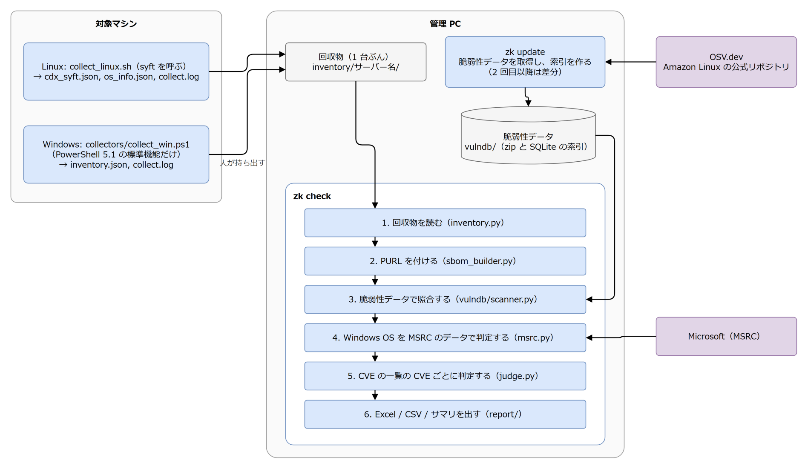

# 脆弱確認（zk）の仕組み

この文書は、現在のコードがどう動くかを説明します。概要は [README](https://github.com/hsgwa/cve_chk/blob/main/README.md)、使い方は [docs/usage/](https://github.com/hsgwa/cve_chk/blob/main/docs/usage/README.md)、設計の経緯は [PLAN.md](https://github.com/hsgwa/cve_chk/blob/main/docs/PLAN.md)、不具合の記録は [DEFECTS.md](https://github.com/hsgwa/cve_chk/blob/main/docs/DEFECTS.md)、他ツールとの比較は [COMPARISON.md](https://github.com/hsgwa/cve_chk/blob/main/docs/COMPARISON.md) にあります。

## 1. 全体の流れ

管理 PC で外部に接続するのは次の 3 つだけです。`zk check` が使う脆弱性データは `zk update` で取得済みのものだけです。

| 接続先 | 使う処理 | 省略する方法 |
|---|---|---|
| OSV.dev（`osv-vulnerabilities.storage.googleapis.com`）、Amazon Linux の公式リポジトリ | `zk update` | `zk update --import 名前=ZIP` で手元の zip を取り込む |
| MSRC（`api.msrc.microsoft.com`） | `zk check`（Windows OS の判定） | `--offline`（キャッシュだけ使う）、`--no-msrc` |
| Maven Central の検索 | `zk check --resolve-hashes` | 指定しない（既定） |

## 2. モジュール構成

| ファイル | 役割 |
|---|---|
| `cli.py` | コマンド `zk update` / `zk check` / `zk preview` / `zk export-sbom` |
| `config.py` | `config.yaml` の読み込みと既定値 |
| `models.py` | データ構造（`Component`、`EnvInventory`、`Advisory`、`Finding`、`Verdict`）と判定の値 |
| `inventory.py` | 回収ファイルの形式判別と読み込み、環境マスタ |
| `purl.py` | PURL の読み取り。ツール内で PURL を読むのはここだけ |
| `sbom_builder.py` | Windows の回収データに PURL を付ける。Trivy 用の CycloneDX も作る |
| `advisory.py` | 会社公表リスト（xlsx / xlsm / csv）の読み込み |
| `vulndb/store.py` | 脆弱性データの取得・差分更新・索引（SQLite）・検索 |
| `vulndb/ecosystems.py` | コンポーネントから、照合するデータの系統とパッケージ名を決める |
| `vulndb/scanner.py` | 影響範囲の評価と照合 |
| `vulndb/versions.py` | エコシステムごとの版の比較（dpkg、RPM、Maven、PEP 440、semver、RubyGems、apk） |
| `vulndb/cvss.py` | CVSS v3 のベクトルから基本値を計算する |
| `vulndb/coverage.py` | データに現れる系統を「使う / 理由つきで使わない / 未分類」に分ける |
| `msrc.py` | Windows OS の CVE を、MSRC の修正ビルド番号で判定する |
| `matching/names.py` | 通達の製品名とコンポーネント名の照合（別名、ワイルドカード、正規表現） |
| `matching/versions.py` | 通達の版条件（`<=3.0.12`、`9.0.*` など）の判定 |
| `matching/rank.py` | 社内ランクと対応期限 |
| `verdict.py` | 通達 × 環境 の判定 |
| `report/tables.py`、`report/writers.py` | 表の組み立てと、Excel / CSV / 標準出力への書き出し |
| `trivy_runner.py` | Trivy を使う場合の呼び出し（任意） |
| `archive_scan.py` | `zk scan-file`: zip / jar / war / ear / whl（と展開したフォルダ）をメモリ上で読み、入れ子の jar もたどって Java・Python・npm・NuGet のライブラリを探し、`inventory.json` の形（OS は `archive`）で書き出す |
| `maven_lookup.py` | jar の SHA-1 から Maven の座標を調べる（任意） |

## 3. 回収と読み込み

### 回収スクリプト

- **Linux**（`collect_linux.sh`）: 持ち込んだ syft の tar.gz を展開して実行し、CycloneDX の SBOM（`cdx_syft.json`）を作ります。OS 情報、EMR のリリースラベル、syft で取れない製品の版（スクリプト内の表に書いた `cmd` / `file` / `exists` / `proc` / `find`）は `os_info.json` に入れます。
- **Windows**（`collect_win.ps1`）: exe を使わず、1 台 1 ファイルの `inventory.json` を作ります。内容は OS（ビルド番号と UBR）、適用済み KB、レジストリのインストール済みソフト、exe / dll の版情報、jar（pom.properties を読む。SHA-1 付き）、Python の dist-info、npm の package.json、NuGet の deps.json、実行中のプロセスとサービスです。項目ごとに `status`（`ok` / `failed` / `skipped`）と理由が入ります。jbom.jar は使いません（[PLAN.md](https://github.com/hsgwa/cve_chk/blob/main/docs/PLAN.md) の冒頭を参照）。

### 形式の判別（`inventory.py`）

`<inventory-dir>` の下のフォルダ 1 つが 1 環境です。フォルダ内の `*.json` を中身で判別して読みます。

| 判別のしかた | 形式 |
|---|---|
| `bomFormat: CycloneDX` | CycloneDX（syft、jbom、Amazon Inspector など） |
| `schema: vuln-triage-inventory/1` | Windows の `inventory.json` |
| `schema: vuln-triage-osinfo/1` | Linux の `os_info.json` |
| `Sources` がある | `winget export` |
| 配列で `HotFixID` がある | `Get-HotFix` |
| 配列で `ProductVersion` などがある | exe / dll の `VersionInfo` |

素の syft の出力（CycloneDX）だけを置いた環境も扱えます。OS は SBOM の `operating-system` の要素と PURL の `distro` から判別し、回収日時は `metadata.timestamp` を使います（`os_info.json` があればそちらを優先）。

CycloneDX か `inventory.json` が 1 つでもあれば「全体を回収した環境」（`full_collection`）とします。これが無い環境で製品が見つからないときは「未使用」ではなく「判定不能」にします。環境マスタに無い環境は `internal`（社内限定）として扱い、警告を出します。

環境マスタにあるのに回収フォルダが無い環境も、環境の一覧に入れます（`not_collected`）。この環境はすべての通達で「判定不能」（判定区分「回収なし」）になり、サマリで警告します。回収し忘れたホストが黙ってレポートから消えないようにするためです。

### 会社公表リストの読み込み（`advisory.py`）

見出しの対応（`advisory_input.columns`）で列を決め、1 行を 1 件の通達にします。1 セルに複数の CVE があれば CVE ごとに分けます。読み落としの恐れがあるものは警告にします（`zk check` の画面とサマリシート、`zk preview`）。

| 読み落としの恐れ | 扱い |
|---|---|
| データのある他のシート | 読むのは `advisory_input.sheet`（既定は先頭）の 1 シートだけ。他のシートにデータがあれば警告 |
| 縦に結合したセル | 既定（`fill_merged: true`）で値を各行に引き継ぐ。`false` なら警告 |
| CVE 番号として読めない記載 | `CVE-年-番号（4 桁以上）` に当たらない部分に `CVE` や `年-番号` の形があれば、行番号つきで警告 |

### PURL の付与（`sbom_builder.assign_purls`）

syft の SBOM は最初から PURL を持っています。Windows の回収データには、種類ごとに PURL を付けます（`pkg:maven/<group>/<artifact>@<版>`、`pkg:pypi`、`pkg:npm`、`pkg:nuget`）。groupId の分からない jar には付けません。PURL のあるコンポーネントだけが脆弱性データでの照合の対象です。

## 4. 脆弱性データ（`vulndb/store.py`）

### データ源

| データ | 取得元 | 保存先 |
|---|---|---|
| ライブラリ（Maven、PyPI、npm、NuGet、Go、crates.io、RubyGems、Packagist、Hex、Pub） | OSV.dev のエコシステム別 `all.zip` | `vulndb/osv/<名前>.zip` |
| Ubuntu、Debian、Red Hat、Rocky Linux、AlmaLinux、Alpine | 同上 | 同上 |
| Amazon Linux 2 / 2023 | 公式リポジトリの `updateinfo.xml` を OSV 形式に変換 | `vulndb/amazon/amazon-linux-<版>.zip` |
| Amazon Linux 2 の extras（kernel-5.10 など 73 トピック） | 同上（トピックごと） | `vulndb/amazon/amazon-linux-2-extras-<トピック>.zip` |

`zk update --inventory-dir` は回収データを読み、必要なデータ（`ecosystems.needed_sources`）を自動で選びます。OS パッケージがあるときは、CVSS を引くために `score_sources`（既定 Debian）も取ります。2 回目以降に引数なしで実行すると、取得済みのデータをすべて更新します。

### 索引（`vulndb/index.sqlite`）

記録の本文は zip のまま保存し、SQLite には検索用の索引だけを入れます。メモリに全記録を載せないためです（Ubuntu のデータでメモリ不足になった不具合への対策）。

| テーブル | 内容 |
|---|---|
| `sources` | データごとの保存ファイル、URL、最終確認日時、件数、差分の起点（`cursor`）、全件取得日時（`full_at`）、Amazon のチェックサム |
| `entries` | （系統、正規化したパッケージ名、記録 ID、ファイル、zip 内の名前）。検索はこの表で行う |
| `records` | 差分更新で取った記録の本文（JSON）。`entries.file` は `#delta` |
| `scores` | （脆弱性 ID、ソース名、CVSS v3 の点数）。ソース名は記録 ID の接頭辞（`ghsa`、`ubuntu` など） |

パッケージ名は系統ごとに正規化します（PyPI は `-_.` を `-` にそろえて小文字、それ以外は小文字）。取り下げられた記録（`withdrawn`）は索引に入れません。

### 更新（全件と差分）

- **OSV.dev**: 普段は `modified_id.csv`（更新日時と記録 ID の一覧）を取り、前回の `cursor` より新しい記録だけを 1 件ずつ取り直して `records` に入れます。すべて取れてから反映するので、途中で失敗しても前回の内容が残ります。次のどれかに当たると `all.zip` を全件取り直します: 初回、`--full`、前回の全件取得から `full_refresh_days`（既定 7 日）以上、差分が `max_delta_records`（既定 3000 件）超、保存ファイルが無い。全件を取り直すと、差分で持っていた同じ記録は消します。
- **Amazon Linux**: ミラー一覧から `repomd.xml` を引き、updateinfo のチェックサムが前回と同じなら取得を省きます。CDN に届かない環境向けに、ミラー一覧と同じホストの同じパスも試します。
- 失敗したデータは前回の内容のまま残り、`zk update` は終了コード 1 を返します。
- `zk check` は、最終確認から `max_age_days`（既定 1 日）を超えたデータがあると警告します。

### Amazon Linux の変換

updateinfo の告知 1 件を OSV の記録 1 件にします。告知 ID（ALAS-…）が記録 ID、CVE が `aliases`、各パッケージの版が `fixed` です。src パッケージは除きます。

extras のトピックでは、影響範囲の下限（`introduced`）を「そのトピックでのそのパッケージの最も古い修正版」の系統（エポック:メジャー.マイナー）にします。例えば kernel-5.10 のトピックは下限が `5.10` なので、kernel 4.14 や 5.15 のホストには当たりません。告知ごとに下限を付けると、nginx1 のように同じトピックの中で版が上がるもの（1.20 から 1.22）を見落とします。

Amazon の公式情報には CVSS がありません。同じ CVE の点数を他のデータ（既定 Debian）の `scores` から引きます。

### 系統の分類（`vulndb/coverage.py`）

データに現れる系統（`Ubuntu:22.04:LTS`、`Red Hat:enterprise_linux:9::appstream` など）は、すべて「照合に使う」か「理由があって使わない」に分類してあります。どちらにも当たらない系統が現れると、`zk update` が警告します。データ提供元が新しい系統を足したときに見落としに気づくためです。使わない系統は [DEFECTS.md](https://github.com/hsgwa/cve_chk/blob/main/docs/DEFECTS.md) の 4 章にあります。

## 5. 照合（`vulndb/scanner.py`、`vulndb/ecosystems.py`）

### 問い合わせの組み立て（`build_query`）

コンポーネント 1 件ごとに、PURL から「必要なデータ、照合する系統、パッケージ名、版」を決めます。

| PURL の種類 | 系統 |
|---|---|
| `maven` `pypi` `npm` `nuget` `golang` `cargo` `gem` `composer` `hex` `pub` | 同名のライブラリの系統。Go は `v` を外し、v2 以降のモジュールは subpath 付きの名前にする |
| `deb`（Ubuntu） | `Ubuntu:<版>:LTS`、`Ubuntu:<版>`、`Ubuntu:Pro:<版>:LTS`、`Ubuntu:Pro:<版>` |
| `deb`（Debian） | `Debian:<メジャー版>` |
| `rpm`（Amazon Linux） | `Amazon Linux:2` または `Amazon Linux:2023` |
| `rpm`（RHEL） | `Red Hat:enterprise_linux:<メジャー>:%`（9 まで）と `Red Hat:enterprise_linux:<マイナー版>`（10 から） |
| `rpm`（Rocky / Alma） | `Rocky Linux:<メジャー>`、`AlmaLinux:<メジャー>` |
| `apk`（Alpine） | `Alpine:v<メジャー.マイナー>` |

- OS は PURL の `distro` から取り、無ければ環境の OS 情報を使います。
- OS パッケージは、バイナリパッケージ名に加えてソースパッケージ名（deb の `upstream`、rpm の `source`）でも引きます。ただし rpm で、ソースの版がバイナリの版と違うサブパッケージ（lvm2 2.02.187 の device-mapper 1.02.170 など）はソース名で引きません。RPM のエポックは版に付けます。
- syft が実行ファイルの ELF のパッケージ情報から作る OS パッケージ（`elf-binary-package-cataloger`。Amazon Linux 2023 の実行ファイルに入っている）は、rpm / dpkg のデータベースに同じ名前と版のパッケージがあれば照合しません（読み込み時に `inventory.py` で外す）。エポックを持たないため、エポック付きの修正版と比べると誤検出になるからです。
- 照合しないもの: 版が無い・数字を含まないもの、カーネルのヘッダだけのパッケージ（Ubuntu / Debian の `linux-libc-dev`、`linux-headers-*`、系統名つきの `linux-aws-7.0-headers-*` など）、対応の無い PURL の種類。これらは件数を「収集状況」シートに出します。対応の無い OS は「未対応の OS」として件数を出します。
- 必要なデータが未取得なら照合せず、環境の `missing_db` に件数を記録します。この環境で CVE だけの通達は「判定不能」になります。Amazon Linux 2 で extras のデータが無いときも同じです。

### 影響範囲の評価（`evaluate`、`evaluate_range`）

索引から記録を引き、記録内の `affected` のうち、系統とパッケージ名の両方が一致する項目だけを評価します。1 つの記録に複数のパッケージが載っているためです（名前を確かめずに評価した誤検出があった）。

- `versions` に版が載っていれば影響あり。
- `ranges`（`ECOSYSTEM` / `SEMVER`）は、イベント（`introduced`、`last_affected`、`fixed`）を版の順に並べて、インストール済みの版の位置で判定します。影響ありのときは次の `fixed` を修正版として出します。
- 版を比較できない範囲しか無く、ほかに当たりも無ければ「比較不能」として影響あり（比較不能）にします。
- 参考情報（RustSec の保守終了など `informational` の印があるもの）は除きます。

**Ubuntu Pro**: 通常の系統の情報があればそれだけを使います。Pro（ESM）の系統にしか情報が無いときも版番号で判定します。加えて、修正版から esm の印（`+esm1`、`~esm2`）を外した版と同じ版を入れていれば、影響ありにします（Pro の修正を含まない。`~esm` は番号の比較で通常の版より小さくなるため、番号の比較だけでは修正済みに見える）。備考に「修正版は Ubuntu Pro（ESM）でのみ提供」と出します。以前は版番号によらず影響ありとしていましたが、Livepatch の告知（LSN）を修正済みの新しいカーネルにも当てはめて大量に誤検出したため改めました。

**縮小版**: 64 KB 以上の記録（Ubuntu のカーネルの CVE。カーネルの系統ごとに 277 項目が並び、1 件 0.5 MB 前後）は、照合に使う項目だけを残した縮小版を zlib で圧縮して索引（`slim` テーブル）に入れ、照合ではこちらを読みます。`versions`（影響のある版の列挙）は、範囲（ECOSYSTEM / SEMVER）の無い項目だけ残します。0.2.0 より前の索引には縮小版が無いので、`zk update` の実行時に手元のデータから作ります。

**評価の使い回し**: Ubuntu のカーネルは 1 つのソースパッケージに数千件（1 件 0.5 MB 前後）の記録があり、同じソースのバイナリパッケージが 10 個前後あります。（系統、パッケージ名、版）が同じなら評価の結果を使い回します。

検出は記録内の CVE ごとに 1 件の `Finding` にします（CVE が無ければ記録 ID）。CVSS は `scores` から引き、`cvss_source_priority`（既定 `nvd`）のソースを優先し、無ければ最大値を使います。同じ環境・CVE・パッケージ・版・パスの重複はまとめます。

## 6. 版の比較

| 場所 | 用途 |
|---|---|
| `vulndb/versions.py` の `compare(系統, a, b)` | 脆弱性データの影響範囲と、通達の版条件の両方で使う比較の入口 |
| `matching/versions.py` の `version_matches_in` | 通達の版条件（`<=3.0.12`、`>=2.0, <2.15`、`9.0.*`）の判定 |

系統ごとの規則は次のとおりです。専用の規則で読めない版は汎用の比較を試し、それでも読めなければ比較不能です。

| 規則 | 系統 |
|---|---|
| dpkg | Debian、Ubuntu |
| RPM（rpmvercmp） | Red Hat、Rocky、Alma、Amazon Linux など |
| Maven | Maven |
| PEP 440 | PyPI |
| semver | npm、Go、crates.io、Hex、Pub、NuGet、Packagist |
| RubyGems | RubyGems |
| apk | Alpine |

通達の版条件は、コンポーネントの PURL の種類（無ければコンポーネントの種類）から規則を決めます。規則が分からないもの（インストール済みソフト、exe など）は PEP 440 で比べ、`8u392` や `3.4.1-amzn-2` のような版は数字部分を取り出して比べます。それでも比べられなければ「影響あり（比較不能）」です。

## 7. Windows OS の判定（`msrc.py`）

通達に CVE があるとき、MSRC の Security Update API でその CVE の修正情報（製品、KB、修正ビルド番号 `10.0.19045.3803` の形）を引きます。結果は `cache/msrc/<CVE>.json` に保存し、次回からはキャッシュを使います。

Windows の環境では、回収した OS ビルド（`10.0.<ビルド>.<UBR>`）と、同じ系列（先頭 3 つ）の修正ビルドを比べます。

| 状況 | 判定 |
|---|---|
| UBR が修正ビルドより小さい | 影響あり |
| UBR が修正ビルド以上 | 影響なし（適用済み） |
| 同じ系列の修正が無く、`msrc.eol_builds` のビルド | 判定不能（サポート切れ） |
| 同じ系列の修正が無い | 対象外 |
| OS ビルドを回収できていない | 判定不能 |

MSRC に修正情報がある CVE は Windows OS の脆弱性とみなし、Windows 以外の環境は（脆弱性データで検出が無ければ）対象外にします。累積更新は修正ビルドで判定するので、KB 番号を通達に書く必要はありません。

## 8. 通達 × 環境 の判定（`verdict.py`）

通達 1 件と環境 1 つの組ごとに、必ず 1 つ以上の行を出します。通達の書き方で判定のしかたが変わります。

| 通達の内容 | 判定のしかた |
|---|---|
| CVE 番号 | 脆弱性データの検出（5 章）と MSRC（7 章） |
| KB 番号（製品名欄に `KB5034441` など） | 適用済み KB の一覧と比べる。Windows 以外は対象外、KB を回収できていなければ判定不能 |
| 製品名（と版条件） | 製品名でコンポーネントを探し、版条件で判定する |
| CVE と製品名の両方 | 両方の結果を出す。同じパッケージ・版で両方が影響ありなら 1 行にまとめる（判定区分「CVE（脆弱性DB＋ルール）」） |

環境マスタにだけあって回収フォルダが無い環境は、通達の内容によらず「判定不能」です。OS を回収データから判別できない環境は、KB と Windows OS の CVE の通達で「対象外」にせず「判定不能」にします。

製品名での判定（`_judge_product`）の詳細です。

- 製品名は NFKC で正規化して完全一致で比べます。`config.yaml` の `aliases`、ワイルドカード（`HULFT*`）、正規表現（`re:^HULFT\d`）も使えます。Maven は `group:artifact` でも当たり、exe はファイル名でも当たります。
- 版条件があれば 6 章の規則で判定します。版条件が無く CVE も無ければ、全版を対象として影響ありにします。
- 版条件が無く CVE がある場合、そのコンポーネントを脆弱性データで照合済みなら影響なし、未照合なら影響あり（比較不能）です。
- 製品が見つからないとき: 版取得に失敗した製品なら判定不能、回収ファイルが無い・収集が未完了・一部だけの回収なら判定不能、それ以外は未使用です。

CVE だけの通達で何も当たらないときは、照合できたパッケージがあれば「影響なし（CVE未検出）」、データが無くて照合していないパッケージがあれば判定不能です。

1 つの組で複数の行が出たら、影響ありの行があればそれだけを残します。無ければ次の順で最初に当たる値の行を残します: 判定不能、影響なし、影響なし（CVE未検出）、対象外、未使用。

影響ありの行には社内ランクと対応期限を付けます（9 章）。通達に無い CVE の検出は「新規検出（参考）」として別に出します（`--only-advisory` で出さない）。

## 9. 社内ランクと対応期限（`matching/rank.py`）

1. CVSS v3 と公開区分（internet / internal）から、`config.yaml` の `rank_matrix` でランクと日数を決めます。CVSS 不明は `default_rank`（Rank-C、90 日）です。
2. 通達に社内ランクがあればそれを使い、日数はそのランクの既定値にします。通達に日数があればその日数を使います。
3. 期限は「通達の公表日（無ければ実行日）＋日数」です。実行日を過ぎていれば備考に「期限超過」と出します。

## 10. 出力（`report/`）

| ファイル | 内容 |
|---|---|
| `report.xlsx` | シート「サマリ」「通達別一覧」「通達×環境」「明細」「新規検出（参考）」「収集状況」 |
| `report_summary.csv` | 通達ごとの総合判定と、判定ごとの環境の一覧 |
| `report_detail.csv` | 通達 × 環境 × パッケージの明細 |
| `report_new_findings.csv` | 通達に無い検出 |

通達の総合判定は、環境ごとの結果のうち次の順で最初に当たるものです: 影響あり、判定不能、影響なし、対象外、未使用。「収集状況」シートには、環境ごとの回収ファイル、OS、コンポーネント数、照合した件数、照合しなかったものの件数と理由、読めなかったフォルダ、スキャン範囲外で動いている実行ファイル、回収からの日数（`stale_days` 超で警告）を出します。

## 11. 任意の機能

- **Trivy**（`--scanner trivy`）: Windows の回収データから CycloneDX を作り（`work/sbom/`）、`trivy sbom` で照合します。syft の SBOM の Amazon Linux（OS 名 `amzn`）は Trivy では照合されないため、Amazon Linux を含む場合は既定の `osv` を使います。
- **jar の SHA-1 照会**（`--resolve-hashes`）: groupId の分からない jar を Maven Central で検索し、結果を `cache/maven_sha1.json` に保存します。外部に送るのはハッシュ値だけです。
- **CVE の照合なし**（`--scanner none`）: 製品名と KB の通達だけを判定します。

## 12. 品質の確かめ方

| 方法 | 内容 |
|---|---|
| `pytest` | 単体テストと静的な検査（`tests/test_static_checks.py`）。PURL の読み取りは `purl.py` だけか、版の比較の入口は決まった場所だけか、記録の評価でパッケージ名を確かめているか、PowerShell の誤りやすい書き方が無いか、保存ファイル名が Windows で使えるか、`zk update` のオプションの組み合わせ |
| `tools/audit_vulndb.py` | 実データの監査。系統の分類（A）、extras の網羅（B）、版の比較規則と範囲の順序（C）、照合結果の不変条件（D1〜D5）。問題があれば終了コード 1 |
| 4 ツール比較 | 同じ SBOM を Trivy・Grype・OSV-Scanner にかけて比べる（[COMPARISON.md](https://github.com/hsgwa/cve_chk/blob/main/docs/COMPARISON.md)）。データ源や判定を変えたら再実行する |

実機での確認の結果は [COMPARISON.md](https://github.com/hsgwa/cve_chk/blob/main/docs/COMPARISON.md) の「実機での確認」にあります。CI（`.github/workflows/ci.yml`）は、push のたびに単体テスト（Windows / Linux、Python 3.10 / 3.13）、Windows Server 2025 での回収・照合・タスクの登録と実行、Amazon Linux 2023 と Ubuntu 24.04 のコンテナでの回収・照合を行います。まだ確かめていないこと: Maven Central への実際の接続（`--resolve-hashes`）と、Windows Server 2016 / 2019 などの古い版です。
