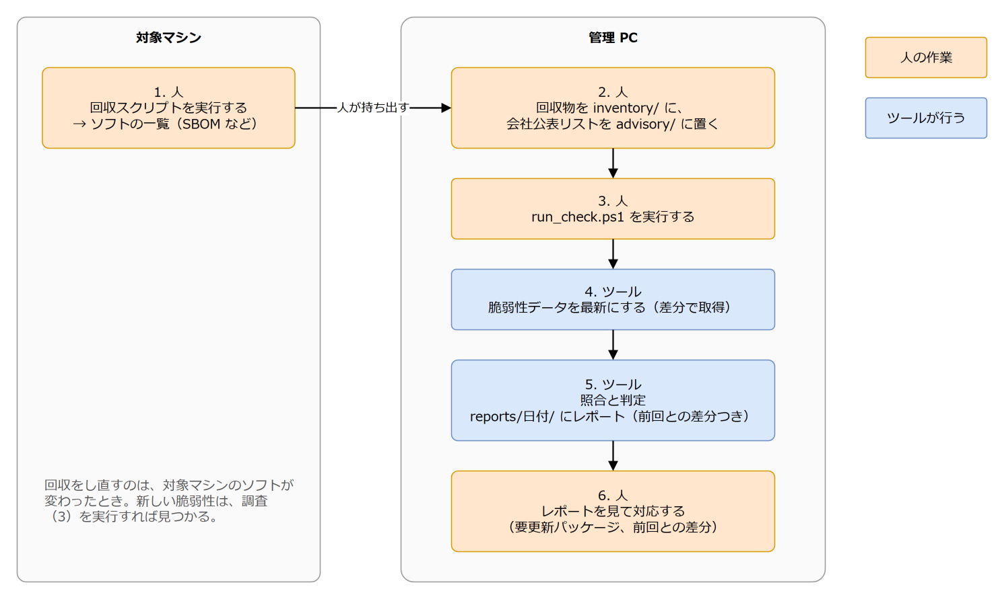

# 本番導入の計画

実際の運用に入るための計画です。何をツールが行い、何を人が行うか、本番投入までに確かめること、残っているリスクと判定できない範囲を 1 か所にまとめます。ツールの概要と用語は [README](https://github.com/hsgwa/cve_chk/blob/main/README.md)、日々の操作は [USAGE.md](https://github.com/hsgwa/cve_chk/blob/main/docs/USAGE.md)、運用の細かな手順と困ったときの対処は [OPERATIONS.md](https://github.com/hsgwa/cve_chk/blob/main/docs/OPERATIONS.md) を参照してください。

## 1. 全体の流れ



| 工程 | 誰が | 頻度の目安 | 仕組み |
|---|---|---|---|
| 回収（対象マシンで実行） | 人 | 月 1 回など（下の 3 章） | `collect_linux.sh` / `collect_win.ps1` |
| 回収物の持ち出しと配置 | 人 | 回収のたび | `inventory\<環境名>\` に置く |
| 会社公表リストの配置 | 人 | 通達が出るたび | `advisory\` に置く（最も新しいファイルを使う） |
| 環境マスタの更新 | 人 | ホストの増減のたび | `env_master.csv` |
| 調査の実行 | 人（コマンド 1 つ） | 通達が出たとき、回収物を入れ替えたとき、定期（週 1 回など） | `check_all.ps1`。中ではツールが脆弱性データの更新（差分）、照合、レポートの作成を順に行う |
| レポートの確認と対応 | 人 | 調査のたび | 「前回との差分」「要更新パッケージ」から見る |

## 2. 管理 PC の準備

1. Python 3.10 以降を入れ、リリースの版を取得して `pip install -e .` する（[USAGE.md](https://github.com/hsgwa/cve_chk/blob/main/docs/USAGE.md) の 1 章）。
2. 作業フォルダを作る（ローカルのディスク。`%TEMP%` のような自動で掃除される場所は不可）。

   ```
   D:\vuln\
     inventory\        回収物（<環境名>\ ごと）
     advisory\         会社公表リスト
     env_master.csv    環境マスタ
     reports\          レポート（自動。証跡なので消さない）
     logs\             実行ログ（自動。90 日で消える）
   ```

3. 初回のデータ取得: `zk update --inventory-dir D:\vuln\inventory`（数十分、2.3 GB 程度。空きは 5 GB 以上を用意する）。
4. 試しに調査を実行する（ツールのフォルダで）:

   ```
   powershell -ExecutionPolicy Bypass -File scripts\check_all.ps1 -BaseDir D:\vuln
   ```

   `D:\vuln\logs\run_<日付>.log` の最後が「終了: 成功」になり、`reports\<日付>\` ができることを確かめる。

`check_all.ps1` の終了コード: 0 = 成功、1 = データの更新の一部に失敗したが照合はできた（前回のデータを使った）、2 = 照合できなかった（回収物や会社公表リストが無いなど）。

## 3. 人の作業

| 作業 | 担当の例 | 頻度 | 確かめること |
|---|---|---|---|
| 対象ホストを環境マスタに登録する | 管理者 | ホストの増減のたび | 登録したのに回収物が無い環境は「判定不能（回収漏れ）」になる |
| 回収する | 各環境の担当 | 月 1 回など。重要なホストや変更の多いホストは多めに | Linux は root、Windows は管理者で実行。`syft_<版>_checksums.txt` も持ち込む |
| 回収物を `inventory\` に置く | 管理者 | 回収のたび | 古い回収物は同じ環境名のフォルダごと置き換える |
| 会社公表リストを置く | 管理者 | 通達のたび | 置いたら `preview --advisory` で警告（読まなかったシート、結合セル、読めない CVE）と、製品名の当たり方を見る。表記ゆれは `config.yaml` の `aliases` に登録する |
| 調査を実行する（`check_all.ps1`） | 管理者 | 通達が出たとき、回収物を入れ替えたとき、定期（週 1 回など） | ログの最後が「終了: 成功」か |
| レポートを見る | 対応担当 | 調査のたび | 「前回との差分」の「新たに影響あり」、サマリの注意事項（回収漏れ、古いデータ、照合できなかったもの） |
| 対応を決める | 対応担当 | 影響ありのたび | 「影響あり」は版の一致。実際に攻撃できるかは人が判断する。「要更新パッケージ」の版に上げる |
| 「判定不能」を解消する | 管理者 | 出るたび | 明細の備考の理由（回収漏れ、syft の失敗など）を解消する |
| 個別製品の版の取り方を書く | 各環境の担当 | 製品を入れたとき | HULFT / DataMagic など、パッケージ管理の外の製品（[USAGE.md](https://github.com/hsgwa/cve_chk/blob/main/docs/USAGE.md) の「HULFT / DataMagic などの商用ソフト」） |
| 定期の保守 | 管理者 | 下の 6 章 | |

回収の頻度の考え方: 調査のたびに脆弱性データを最新にしてから照合するので、**新しい脆弱性は回収をし直さなくても、調査を実行すれば見つかります**。回収をし直す必要があるのは、対象のサーバーのソフトが変わったとき（更新、追加）です。回収から 90 日を過ぎると「収集状況」シートで警告が出ます（`config.yaml` の `stale_days`）。

## 4. 本番投入前のチェックリスト

- [ ] 本番と同じ構成の検証機で、回収の所要時間と CPU・メモリを測った（[OPERATIONS.md](https://github.com/hsgwa/cve_chk/blob/main/docs/OPERATIONS.md) の 1 章）
- [ ] 検証機の回収結果で、主要な製品（Java、Web サーバー、HULFT、DataMagic など）が出ていることを `preview` で確かめた
- [ ] HULFT / DataMagic の版の取り方を、両方の回収スクリプトに書いた（書くまでは「存在する（版不明）」= 影響あり（比較不能））
- [ ] 会社公表リストの見出しを `config.yaml` の `advisory_input` に合わせ、`preview --advisory` で警告が無いことを確かめた
- [ ] 環境マスタに対象のホストをすべて登録し、公開区分（internet / internal）を確かめた
- [ ] 社内ランクと期限の決め方（`config.yaml` の `rank_matrix`）が社内の規程と合っていることを確かめた
- [ ] 管理 PC の作業フォルダの権限を担当者だけに絞った（回収物とレポートは機密情報）
- [ ] 管理 PC から次に接続できることを確かめた: `osv-vulnerabilities.storage.googleapis.com`、`amazonlinux.default.amazonaws.com` などの Amazon Linux のリポジトリ、`api.msrc.microsoft.com`
- [ ] `check_all.ps1` を 1 回実行し、「終了: 成功」とレポートができることを確かめた
- [ ] 調査を実行する頻度と担当を決めた（通達が出たとき、回収物を入れ替えたとき、定期）
- [ ] 回収の手順（持ち込むもの、実行するコマンド、持ち出す場所）を各環境の担当に渡した
- [ ] 最初の 1 か月は、結果を手でも確かめる（主要な通達について、実際に入っている版と判定が合っているか）

## 5. リスクと対策

| リスク | 起きること | ツールでの対策 | 人がすること |
|---|---|---|---|
| 回収が古い・漏れる | 新しく入れたソフトや、回収していないホストの脆弱性を見落とす | 回収漏れは「判定不能（回収漏れ）」、90 日超は警告、走査範囲外で動いているプログラムを「収集状況」に表示 | 回収の頻度を決めて守る。警告を見たら回収し直す |
| 判定できない範囲がある | 下の 7 章のものを見落とす | 範囲はサマリと文書に明記 | 範囲外のものは別の方法（製品の通知、手での確認）で見る |
| 製品名の表記ゆれ | 入っているのに「未使用」になる | `preview` で当たり方を表示 | 通達ごとに確かめ、`aliases` に登録する |
| 影響ありが多すぎる | 対応しきれず、重要なものが埋もれる | 「要更新パッケージ」でまとめる。ランクと期限の順に並べる。「前回との差分」で新しいものだけを見られる | ランクの高いもの、internet のものから対応する。カーネルなど再起動が要るものは計画的に更新する |
| 調査を実行し忘れる・脆弱性データが更新されない | 新しい脆弱性に気づくのが遅れる | `check_all.ps1` は照合の前に必ずデータを更新する。1 日を超えて古いデータで照合すると警告。更新に失敗したデータは前回の内容で照合し、終了コード 1 | 調査の頻度と担当を決めて守る。終了コード 1 が続く場合は管理 PC の接続を確かめる |
| データ提供元の形式の変化 | 新しい系統の情報を見落とす | 分類されていない系統が現れたら `update` が警告（[DEFECTS.md](https://github.com/hsgwa/cve_chk/blob/main/docs/DEFECTS.md)） | 警告が出たら、使う系統か確かめてツールを直す |
| syft の改ざん・破損 | root で不正なプログラムを実行する | 配布元のチェックサムと一致しなければ実行しない | `syft_<版>_checksums.txt` を一緒に持ち込む。必須にするなら `REQUIRE_SYFT_CHECKSUM=1` |
| 対象サーバーへの負荷 | 業務処理が遅くなる | 既定で優先度を最低にする。syft は 3 時間で打ち切る。メモリの回収を早める（目安 1 GiB）。空きが 500 MB 未満なら何も書かずに止める。ファイルをロックしない | 業務の少ない時間帯に実行する（終わった後もしばらくファイルキャッシュの影響が残る）。検証機で測る |
| 対象サーバーに残るもの | 回収の後にファイルが残る | 書き込みはスクリプトを置いたフォルダの中だけ。フォルダごと消せば元に戻る（CI で毎回確かめる） | 回収後にフォルダを消す。個別製品の `cmd` を足すときは、そのコマンドが書くものを検証機で確かめる |
| 回収物・レポートの漏えい | 攻撃者に構成を知られる | 外部に送るのはデータの名前、CVE 番号、（任意で）jar の SHA-1 だけ | 管理 PC と作業フォルダの権限を絞る。不要な回収物は消す |
| ウイルス対策ソフト | 脆弱な jar が隔離され、回収されない。脆弱性データのファイルが消える | データのファイルが消えても `update` で自動で取り直す | 消える場合は作業フォルダを除外の対象にするか相談する |
| 会社公表リストの書式の変化 | 読み込めない、または読み落とす | 見出しが見つからなければ止まる（終了コード 2）。読まなかったシートなどは警告 | 書式が変わったら `advisory_input` を直す |
| ツールの古さ | 新しい syft の出力形式に合わない。依存ライブラリの脆弱性 | CI が push のたびに、最新の syft でも回収から照合まで試す | 下の 6 章の定期の保守 |
| 担当者の交代 | 運用が止まる | 手順を文書にまとめた（この文書、[OPERATIONS.md](https://github.com/hsgwa/cve_chk/blob/main/docs/OPERATIONS.md)） | 引き継ぎでこの文書を渡す |

## 6. 定期の保守

| 頻度 | 作業 |
|---|---|
| 調査のたび | ログの最後の行が「終了: 成功」か |
| 毎月 | 回収。`preview` で回収結果と警告を確かめる |
| 3 か月ごと | syft を新しい版にする（CI が最新の版で通っていることを確かめてから）。`pip install -U` で依存ライブラリを更新する。実データの監査（`python tools/audit_vulndb.py --db-dir vulndb --inventory-dir inventory`） |
| 半年ごと | 他のツール（Grype など）と結果を比べる（[COMPARISON.md](https://github.com/hsgwa/cve_chk/blob/main/docs/COMPARISON.md) の手順）。比べるツールも最新の版にし、データの作成日時を確かめる |
| ツールを更新したとき | [CHANGELOG.md](https://github.com/hsgwa/cve_chk/blob/main/CHANGELOG.md) を読む。CI が通っている版（リリース）を使う |

## 7. 判定できない範囲（まとめ）

| 範囲 | 理由 | 代わりの方法 |
|---|---|---|
| 脆弱性データに無い製品（商用ソフトなど） | OSV.dev と Amazon Linux の公式情報に無い | 会社公表リストに製品名と版の条件を書く |
| 実行ファイル本体（カーネルのイメージ、node・python のバイナリ、Go / Rust 製の exe の内部） | パッケージの情報が無い（CPE での照合は行わない） | OS パッケージ（カーネル、python3 など）として入っていれば照合される。それ以外は製品名と版の条件で書く |
| Windows の OS 以外の Microsoft 製品（Office、SQL Server、.NET ランタイムなど） | Windows OS の判定は OS のビルド番号だけを見る | 会社公表リストに製品名と版の条件を書く（インストール済みソフトの版と照合する） |
| Ubuntu の修正版がまだ無い CVE | OSV.dev の Ubuntu のデータに載らない | 修正版が出ると載る。急ぐものは Ubuntu の告知で確かめる |
| RHEL の追加製品（OpenShift、JBoss など）、延長サポート（EUS）、Ubuntu の FIPS / Realtime | 別の系統の情報で、使っていない（[DEFECTS.md](https://github.com/hsgwa/cve_chk/blob/main/docs/DEFECTS.md) の 4 章） | 該当するホストは製品の告知で確かめる |
| コンテナの中身、Lambda の実行環境（ランタイムと OS）、AWS マネージドサービス側 | 回収の対象外 | Lambda のデプロイ用 zip・レイヤー、war・jar は `zk scan-file` で調べる。コンテナイメージは syft で回収する（[USAGE.md](https://github.com/hsgwa/cve_chk/blob/main/docs/USAGE.md) の「zip・jar・war などのファイルを調べる（Lambda など）」）。ランタイムのサポート終了日は AWS の文書で確かめる |
| 版を取れない製品（HULFT などで版の取り方を書いていないもの） | 存在だけ分かる | 「影響あり（比較不能）」になる。版の取り方を書く |
| 権限不足で読めなかったフォルダ、走査範囲外のフォルダ | 回収できない | 「収集状況」の「読めなかったフォルダ」「スキャン範囲外で動作中」を見て回収し直す |
| 実際に攻撃できるか | 版の一致だけを見る | 人が判断する |

## 8. 未対応のもの（今後の改善の候補）

| 項目 | 内容 |
|---|---|
| 会社公表リスト無しでの自主点検 | 今は見出しだけのリストを置く回避策が必要 |
| Windows の OS 以外の Microsoft 製品の自動判定 | MSRC のデータで、インストール済みソフトの版と照合する |
| 実行ファイル本体の照合 | Grype との差の大部分。CPE での照合が必要 |
| 古い Windows Server（2016 / 2019）での確認 | CI の Windows Server は 2025 だけ |
