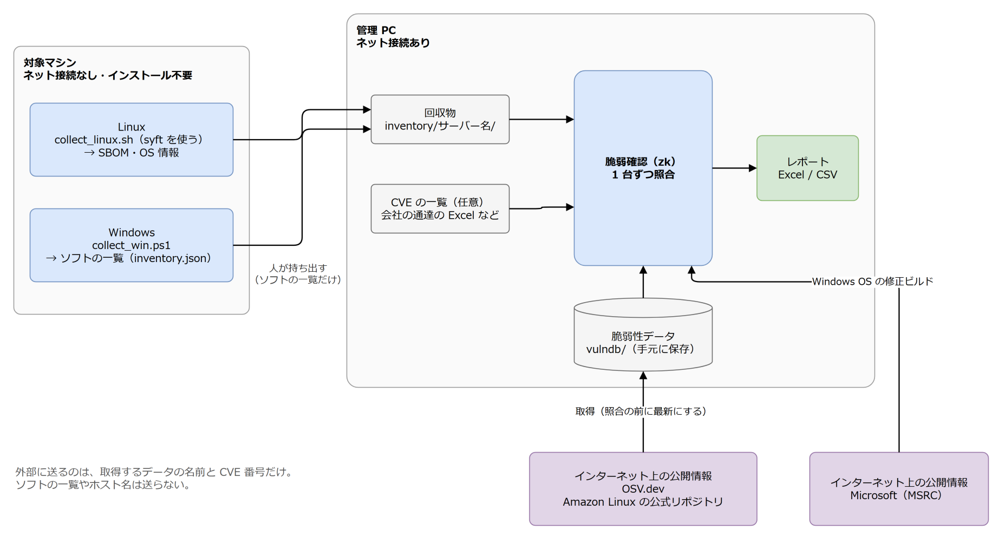

# はじめに

初めて使う人は、このページを上から順に読んで進めてください。

## このツールでできること

サーバーに入っているソフトを調べて、**どの脆弱性があるか**と、**どのソフトをどの版に上げれば直るか**を Excel のレポートにします。インターネットにつながらないサーバーも調べられます。会社から「この CVE に対応すること」という通達が来たら、その CVE ごとに影響の有無も出せます。



1. 調べたいサーバーで、入っているソフトの一覧を作る（**回収**）。
2. 一覧を、インターネットにつながる PC（**管理 PC**）に持ってくる。
3. 管理 PC で、1 台ずつ脆弱性の情報と突き合わせ、レポートを作る。

## 言葉

| 言葉 | 意味 |
|---|---|
| 対象マシン | 脆弱性を調べたいサーバー |
| 管理 PC | このツールを動かす PC。インターネットにつながっていること |
| 回収物 | 対象マシンで作った、ソフトの一覧のファイル。サーバー 1 台につきフォルダ 1 つ |
| CVE の一覧 | 調べたい脆弱性の CVE 番号の一覧。会社の通達の Excel をそのまま使える。無くてもよい |
| 作業フォルダ | 回収物・CVE の一覧・レポートを置くフォルダ。この文書では `D:\vuln` |

## まず試す（5 分）

1. [リリース](https://github.com/hsgwa/cve_chk/releases)から `zeijaku-kakunin-<版>-windows-x64.zip` を取得し、展開する（例 `D:\zk`）。インストールも管理者の権限も要りません。
2. 展開したフォルダでコマンドプロンプトを開き、次を実行する。

   ```
   zk demo
   ```

3. 表示された `report.xlsx` を開く。同梱のサンプル（架空のサーバー 4 台）のレポートの見本です。読み方は [report.md](https://github.com/hsgwa/cve_chk/blob/main/docs/usage/report.md) にあります。

コマンドは、展開したフォルダ（ツールのフォルダ）で実行します。PowerShell では `zk` の代わりに `.\zk` と打ちます。

## 本番で使う

### 1. 作業フォルダを作る

```
zk init D:\vuln
```

`D:\vuln` に、回収物の置き場所（`inventory`）、CVE の一覧の置き場所（`cve_list`）、説明（`はじめに.txt`）ができます。

### 2. 対象マシンで回収する

ツールのフォルダの `collectors\` にある回収スクリプトを、対象マシンに持っていって実行します。

| 対象マシン | 実行するもの |
|---|---|
| Linux | `collect_linux.sh` と [syft](https://github.com/anchore/syft/releases)（`syft_<版>_linux_amd64.tar.gz` と `syft_<版>_checksums.txt`）を同じフォルダに置き、`sudo bash collect_linux.sh` |
| Windows | `collect_win.ps1` を置き、管理者の PowerShell で `powershell -ExecutionPolicy Bypass -File collect_win.ps1` |

できた `out\<ホスト名>\` フォルダを管理 PC に持ってきて、`D:\vuln\inventory\` の下にフォルダごと置きます。対象マシンでは、スクリプトを置いたフォルダを消せば元どおりです。詳しくは [collect.md](https://github.com/hsgwa/cve_chk/blob/main/docs/usage/collect.md)。

### 3. CVE の一覧を置く（任意）

会社の通達の Excel などがあれば、`D:\vuln\cve_list\` に置きます。**書式は問いません。** どこかのセルに `CVE-2021-44228` のような CVE 番号が書いてあれば読みます。無ければ、見つかった脆弱性をすべて出します。

### 4. 調べる

全サーバーを 1 台ずつ調べるとき:

```
powershell -ExecutionPolicy Bypass -File scripts\check_all.ps1 -BaseDir D:\vuln
```

1 台だけ調べるとき:

```
zk update --inventory-dir D:\vuln\inventory\web01
zk check D:\vuln\inventory\web01 --cve-list D:\vuln\cve_list\通達.xlsx
```

`check_all.ps1` は、脆弱性の情報をインターネットから取得（2 回目からは差分だけ更新）してから照合し、`D:\vuln\reports\<日付>\<サーバー名>\report.xlsx` を作ります。最後に「終了: 成功」と出れば完了です。**初回は情報の取得（約 2.3 GB）に数十分かかります。** 空きを 5 GB 以上用意してください。詳しくは [check.md](https://github.com/hsgwa/cve_chk/blob/main/docs/usage/check.md)。

### 5. レポートを見る

| シート | 見ること |
|---|---|
| CVE の判定 | CVE の一覧の CVE ごとに、影響あり / 影響なし / 判定不能（一覧を渡したときだけ） |
| 要更新ソフト | どのソフトを、どの版以上に上げれば直るか。**対応はここから** |
| 脆弱性の一覧 | 見つかった脆弱性すべて |

詳しくは [report.md](https://github.com/hsgwa/cve_chk/blob/main/docs/usage/report.md)。

次からは、通達が来たら手順 3 と 4、サーバーのソフトが変わったら手順 2 と 4 を繰り返します。

## 詳しい説明

| ページ | 内容 |
|---|---|
| [setup.md](https://github.com/hsgwa/cve_chk/blob/main/docs/usage/setup.md) | 管理 PC の準備、脆弱性の情報の取得、版の入れ替え、アンインストール |
| [collect.md](https://github.com/hsgwa/cve_chk/blob/main/docs/usage/collect.md) | 対象マシンでの回収 |
| [scan-file.md](https://github.com/hsgwa/cve_chk/blob/main/docs/usage/scan-file.md) | zip・jar・war のファイルを調べる（Lambda など） |
| [files.md](https://github.com/hsgwa/cve_chk/blob/main/docs/usage/files.md) | 作業フォルダ、回収物、CVE の一覧 |
| [check.md](https://github.com/hsgwa/cve_chk/blob/main/docs/usage/check.md) | 調べ方とオプション |
| [report.md](https://github.com/hsgwa/cve_chk/blob/main/docs/usage/report.md) | レポートの読み方、判定の意味、結果の限界 |
| [OPERATIONS.md](https://github.com/hsgwa/cve_chk/blob/main/docs/OPERATIONS.md) | 運用の注意と、困ったとき |
| [ROLLOUT.md](https://github.com/hsgwa/cve_chk/blob/main/docs/ROLLOUT.md) | 本番導入の計画（分担、チェックリスト、リスク） |

## コマンドの一覧

| コマンド | すること |
|---|---|
| `zk demo` | サンプルでレポートの見本を作る |
| `zk init <フォルダ>` | 作業フォルダを作る |
| `zk update` | 脆弱性の情報を最新にする |
| `zk check <回収物のフォルダ>` | 1 台を調べてレポートを出す |
| `zk preview <回収物のフォルダ>` | 回収物と CVE の一覧が読めるかを見る（照合しない） |
| `zk scan-file` | zip・jar などのファイルを調べて回収物にする |
| `zk export-sbom` | Windows の回収物から SBOM を書き出す（Trivy を使う場合） |
| `scripts\check_all.ps1` | 作業フォルダの全サーバーを 1 台ずつ調べる |

オプションは `zk <コマンド> --help` で見られます。
